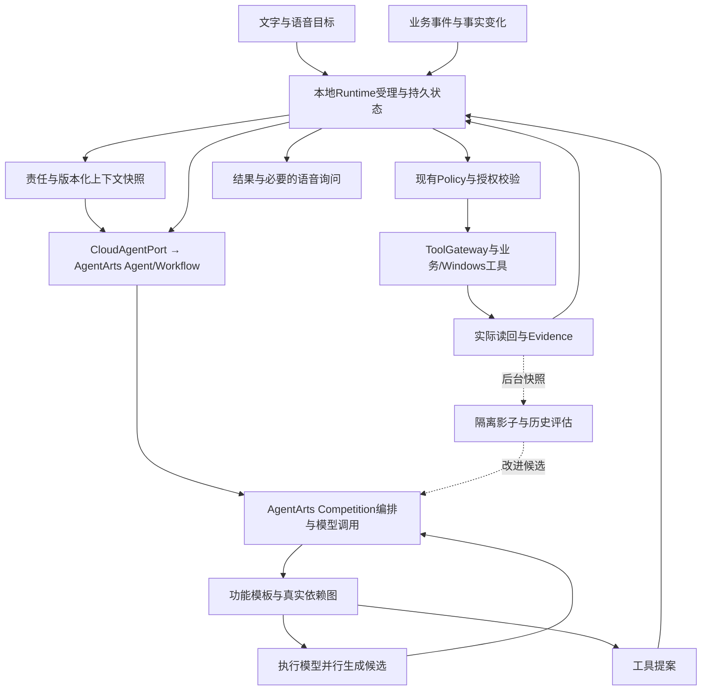

# PersonalAgent 最终主架构

版本：2026-10-14 · 目标 profile：huawei_ict_agentarts · 代码核对基线：main 3275aa91。

本设计依据已合并的架构查看器 PR #347及用户确认的28功能方案。它确定未来实施方向，不宣布现有代码已经重构。Astra对主架构的复评已用于#347；本次文档重写仍需正常PR审查。

## 1. 用户得到什么

用户通过主对话或语音提出目标，系统在已授权的责任范围内自行选路、分派、执行、核实和跟进。界面只需展示目标、正在处理的事项、结果与需要用户决定的问题。模型、图、Scope和内部检查放在详情与设置中，不成为日常使用的必填项。

本地Windows Runtime保留任务状态、检查点、授权与执行Evidence；Competition Profile 经 CloudAgentPort 调用 AgentArts，由 AgentArts 承担 Agent/Workflow 构建与编排、评估和部署。本机 Laya 已确认为本机运行方案并参与 Competition 产品路径。F01–F28 是设计模板，不表示镜像或平台已完成全部比赛业务。Local Profile 保留现有 runAgent、ModelGateway 与 Provider；AgentArts 失败时不得静默回退到 Local Profile。具体 Laya 调用节点、领域资格、官方比赛资格与端到端验收按可复现 Evidence 核实。

## 2. 一张图与一套事实来源

完整交互图见[index.html](index.html)，28功能的逐节点说明见[WORKFLOWS.md](WORKFLOWS.md)。F01—F28是用户功能，MOD-01—MOD-38（含04A/04B）是39个工程模块，两套编号不互相替代。

TaskRuntime保存任务状态、步骤、检查点与终态；现有Goal/Decision/Plan图表达目标及依赖；Wiki/Memory保存知识与来源。三者职责不同，通过公开端口接线，不能另建第二套任务库、调度器或授权系统。

## 3. Competition 与 Local 的决策边界

Competition Profile 经 CloudAgentPort 调用 AgentArts；AgentArts 承担比赛路径的 Agent/Workflow 编排和模型调用，并负责构建、评估与部署。该路径不在本地自有镜像中另建编排，也不在 AgentArts 失败后静默回退。具体 CloudAgentPort 能力按当前接口目录记录；目录或设计图本身不构成生产验收。

Local Profile 仅保留现有 runAgent、ModelGateway 与 Provider，不在本轮新增或扩展。本机 Laya 在本机运行并参与 Competition 产品路径；既有 typed-choice 实测只覆盖记录的固定版本与场景，不证明全部节点接线、官方比赛资格或真实云端端到端。模型输出只能形成回答或工具提案；可信 Runtime/Policy 校验授权和参数，TaskRuntime 与外部读回应决定实际状态和终态。

并行候选、原生思考参数、MaaS 端点和具体 AgentArts 能力均以当前配置、代码和实际读回为准。历史架构和模型实验保留于对应日期记录，不据此声称新 Competition 能力已经接通。

## 4. 主对话与持续责任

F01接收目标，代码并行读取适用责任、正在执行的任务和有权限的上下文；唯一模型识别单次请求、长期责任或对现有任务的修订。确定性代码检查所选能力、对象与参数，将任务交给F28分派，再交F24推进。

持续责任的设计信息包括目标、适用对象和事件、允许动作、已获授权的范围、有效期、用户偏好、停止/撤销方式、成功条件和来源版本。这些是概念字段，不是已发布DTO。实现应映射已有Goal、授权和配置端口；不能因文档字段不存在便在Renderer维护另一个责任数据库。

已授权范围覆盖当前操作时直接执行，无须每次重复询问。范围外或关键歧义未解决时只询问缺少的一项。模型可以建议任务取舍、选择研究来源、安排执行模型、调整受影响计划、筛选通知、修复失败节点；用户保留改变目标、撤销责任和停止的入口。

用户新指令先识别所指任务及修订范围。修改收件人、金额、文件、动作等会影响确认的参数时，旧确认失效；无关任务与独立分支继续，不因一次询问冻结全系统。

## 5. 事件驱动图与并行

F03接收去重后的事实/业务事件，按稳定ID和revision找到受影响Goal/Decision/Plan。确定性依赖传播先缩小范围，模型只处理需要语义重检的候选，输出KEEP、RECHECK、REVISE或已有契约允许的对应建议。

执行图采用稳定功能模板与按需分支。读取互不依赖的资料、独立分类问题或多个研究来源可以并行；依赖工具结果的分析进入下一轮。F28中的代码生成若需要研究结果，就必须等研究分支，不能为缩短图而删掉真实依赖。

节点描述至少包含输入/输出概念、前置依赖、条件、必需/可选、模型或工具能力、资源键、是否可能产生副作用、验证方式和恢复路径。只有握手已公布的能力才进入可执行目录；架构字段不能直接被当成公共协议。

汇合只等待本轮选中且必需的分支。未选条件分支记为跳过；可选分支失败保留部分结果，不能伪装全成功。恢复环属于后续有界轮次，不允许无限自循环。

## 6. 主对话分配模型与思考深度

用户可以指定执行模型和思考偏好，也可以交给原受信判断链推荐。默认执行候选来自查看器目录中的DeepSeek、GLM、Qwen、openPangu。某模型适合研究或编码是待评测假设，不能根据品牌名称宣布性能优劣。

分派流程：读取真实配置和能力 → 原受信判断链提出分工及依赖 → 代码校验能力/期限/取消 → 映射供应商参数 → 生成必要分支 → 执行候选回传 → 来源/测试独立验证 → 唯一模型提出汇总及完成建议 → Runtime决定终态。

思考设置分为原生模型参数、步骤预算、上下文预算和验证强度。当前公开ReasoningEffort是none/low/medium/high；厂商的max、思考开关或其他扩展不能未经契约适配直接塞入该枚举。服务接受某参数只证明接口接受，不证明真实内部思考量。

复用Runtime的subagentModels、getModelGateway、getModelConfigurationRef和getModelReasoningEfforts；ModelGateway统一模型入口。完整Competition分派、云镜像参数映射与配置版本反馈仍待接线。切换模型保持原任务、操作ID和已发生副作用，不以新模型重做已确认写入。

## 7. 记忆搜索、写入与上下文

F04管理来源绑定的Wiki事实，F05负责检索与排序，F27负责当前调用上下文。KnowledgePort.search是已有知识检索入口；MemoryQueryPort提供事实查询及版本历史，不能被改名成已经交付的向量检索API。

搜索先由代码按读取范围、来源状态、时间与敏感级别过滤，再通过已有索引取候选，唯一模型做语义排序和相关性判断。命中内容保留页/事实身份、revision及引用；无合适来源时明确无匹配，不把模型记忆当作原文。

写入先判断是可保存事实、用户偏好还是暂时执行日志，并保留来源、适用范围、时间和确认状态。模型提出保存/合并建议，现有受信宿主与Policy决定是否获准；相容版本演进与冲突隔离分别处理。已确认责任覆盖的保存无需新增确认，现有逐条私人来源确认路径在对应实现迁移前仍按实际代码执行。

正文写入与SQLite投影不具有天然跨库原子性。复用现有写入意图、原执行回执、投影恢复和精确版本核对；失败只恢复未完成部分，不重写已经确认的正文。

来源变更或撤回使相关事实、检索缓存、摘要和依赖决定失效。缺页或暂时断连属于未知，不能直接推断删除。删除按现有精确版本和副本清单处理；已发往外部的内容不能因本机删除被声称撤回。

上下文先保留当前用户目标、已授权责任、正在使用的版本、工具结果引用和未解决副作用。模型建议裁剪相关性低的内容或形成结构化摘要；代码按实际模型窗口验证可用预算。完整日志可在本地保留，调用中用引用和可恢复摘要，不持续塞入全部聊天。

决定缓存绑定输入、来源版本、目标/参数版本、模型与配置版本；任何相关变化即失效。授权不依赖缓存，执行时再次核验。上下文能力从F28反馈F27，压缩不能替代版本或来源检查。

## 8. 语音主动询问与确认

语音与文字使用同一待确认操作。系统主动播报简明的动作、对象和关键参数，并同步展示文字；用户可以口头同意、拒绝、修改或停止，无须强制点击弹窗。

F02的可信宿主绑定当前问题、会话、待执行操作、参数摘要、revision与有效性。ASR最终转写进入意图理解；明确同意/拒绝先走已有确定性路径，有歧义时由唯一模型提出分类。模型分类不能自行消费授权。

同意：核对当前问题和参数后调用已有授权响应链。修改：先使旧确认无效，更新草稿/操作摘要，再按现有要求询问。条件同意：先处理条件，不丢弃修饰词直接执行。拒绝：阻止对应操作并释放可释放资源，其余独立分支可继续。

中途转写、TTS回声、旧会话回答、否定句和沉默均不能自动放行。超时回到等待/失败或已有恢复路径，不能把等待时间当作同意。

停止播报、结束语音、取消任务和阻止新的工具动作是不同控制。可信本地直接停止不等待云端；口头停止仍依赖有效音频/ASR链，断连时不能保证任意口头指令可识别，所以保留本地直接停止入口。具体语音绑定及生产ASR验收未由本设计完成。

## 9. 授权、工具与证据

沿用Runtime/Policy，不新增限制。模型负责语义建议，既有Policy核验当前责任或一次性授权是否覆盖动作。工具经ToolGateway进入受信连接器/Windows Host；账号凭据只由可信宿主注入，不进入模型、Renderer、公开Evidence或日志。

同一资源的写入按已有规则互斥，鼠标键盘输入串行；互不相关的只读或不同资源任务可并行。授权绑定操作参数与revision，修改后不能复用旧同意。运行标识和幂等身份跨断线、重启及重规划保留。

受理、pending、模型自报完成、Schema合法和外部读回是不同证据。未知写入先查原执行和目标系统，确认未执行才考虑重试；无法核实时进入waiting_reconciliation并保留已发生的结果。任务成功必须满足所选必需分支及真实完成条件，由TaskRuntime记录。

## 10. 三类影子工作流

影子默认后台运行，不增加用户确认，不阻塞日常任务。它使用固定快照与独立输出空间，不能写主任务、主记忆、真实通知或消费主授权。仅在原有执行/发布条件确实要求隔离验证时，阻塞对应节点。

决策影子：旧配置与候选配置针对相同已知输入比较路由、分类、记忆排序、上下文取舍和完成建议。可以多次调用同一个基础模型的候选配置，但主运行仍只有一个生效裁决配置。

轨迹回放：重放当时可见输入与已记录工具结果，不能读取未来信息。影子选择了不同动作且缺少对应反事实工具结果时，标记结果未知，不推测该路线更成功。

隔离执行：使用独立测试数据、服务或工作区产生新结果；只有隔离条件可复现的部分才可比较。主账号凭据与授权不会直接复制给影子。不存在隔离宿主时返回不支持，不能仅用目录名称声称物理隔离。

比较按完全可比、部分可比、缺证据、不可比描述依据。F22产出改进候选，F23使用固定任务集与回归证据评估，版本晋升沿用现有发布条件；拒绝和回滚保留原配置。

## 11. 自调试与配置改进

失败轨迹先由代码归类格式、版本、连接、参数、工具结果未知或语义判断问题。唯一模型选择需要修复的节点，执行模型产生提示/图/补丁候选，客观检查及隔离测试验证，再回放失败输入和关联回归。

不能通过删除测试、放宽正确性或把未知标成功来改善分数。比较输出质量、工具正确性、重复副作用、成本与关键路径；没有结果的分支保留未知。

MaaS API不能直接修改远端执行模型权重。本机Laya持有固定权重，在线推理与训练仍是不同流程；当前改进对象是候选描述、判断题、功能图、检索策略、调用配置和已验证模型版本。权重微调需独立数据/训练/回归/版本和算力工作包，不自动在主Workflow进行。开源权重训练属于另外的训练/数据/算力/评估工作包，不以“自学习”名义隐式开启。本轮文档只修正当前实验叙事；本机Laya与工作流镜像/Huawei部署分别交付；训练费用与权重训练仍未作为普通推理步骤启动。

## 12. 云端镜像、通信与国内执行

Competition Profile 经 CloudAgentPort 让 AgentArts 实际承担构建、部署、Workflow/Agent 编排和评估；本机 Laya 按已确认的本机方案参与 Competition 产品路径。F01–F28 仅为设计模板；本机 Runtime 保存持久任务、私有状态、授权和执行Evidence，云端只接收当前任务需要且允许出机的上下文。Local Profile 只保留现有 `runAgent()`、ModelGateway 与 Provider，不作为 AgentArts 失败后的回退。平台模型、工具、知识、日志和评估能力分别按实际配置及读回验收。

WSS为主通道，HTTPS为显式备用。对已发送而结果未知的操作不能通过备用通道盲发；当前云端回执是有界内存、restartRecovery:false，不能承诺云端持久恢复。沿用独立transport 0.1.0、本地wire 1.0.0及已有候选协议，不把本设计直接写成新Schema。

源码、模型配置、镜像版本/digest、部署版本与一次实际调用分别记录。GHCR历史预览不能证明国内AgentArts可拉取；正式路径使用平台已验证的SWR/镜像导入。ARM64与8080及当前/invocations、/ws入口按已交付镜像契约处理，不在文档中造新的部署路径。

架构页已本地打包，无CDN或在线字体；国内npm镜像是查看器项目配置。生产各连接器另需国内网络读回：现有OpenAlex、Open-Meteo及其他Provider不能仅因已有源码被宣称墙内始终可用。业务层保留可替换Provider，优先国内可达源；不删除已有适配或伪造国内替代已经接通。

## 13. 延迟与资源

真实端到端延迟未知。关键路径耗时为串行阶段求和，再加每个并行阶段的最大耗时及队列/重试等待。不能把节点数量直接换成延迟，也不能保留原演示500ms/零成本数字。

本地受理、状态展示和直接停止不等待模型；事件去重、版本、锁、授权和参数检查直接由代码完成。独立判断按同一快照合批，已有有效决定复用，只重检受影响节点。需要新信息的下一轮调用无法通过合批省掉。

影子、历史评估与非必需整理默认后台，前台结果仅等待必要证据。不要为了“模型各方面参与”让每个机械检查再做一次推理。Competition Workflow 由 AgentArts 承担编排；本机 Laya 是已确认的本机运行方案并参与产品路径，具体调用节点与领域资格按 Evidence 核实。Local Profile 中的其他现有模型服务不因此扩展为比赛裁决入口。确定性步骤由代码完成；真实服务延迟、队列与取消边界必须按对应 Profile 实测，不能承诺固定毫秒延迟。

测试需分别记录本地受理、首个可见结果/首token、工具读回、完整结果、P50/P95、并发排队、取消和超时；区分热会话、冷启动、网络失败、上下文大小和调用轮数。普通语义任务需考虑秒级等待，研究/编码更久；目前不设未经用户确认的固定预算或性能承诺。

## 14. 当前代码与实施

main 3275aa91已包含#347查看器、Wiki/Skill组合与Windows/补丁恢复增量。可复用端口和工厂见[接口目录](../../interfaces/CURRENT_INTERFACE_CATALOG.md)。固定公开合成文件的真实Huawei WSS→MaaS→本地Policy/读取/Evidence→续答已有历史证据，仅证明该场景，不证明完整28功能。

自然语言责任编译、统一唯一决策配置、完整多模型分派、语音问题绑定、版本化上下文缓存、图恢复编排与独立影子宿主仍需实施。不能把本地已有工厂称为新的完整产品能力，也不能把整模块退回“没有任何代码”。

本PR重写文档及生成说明，不修改生产执行链、公共Schema、依赖锁或数据库迁移；用户已授权按分工开始镜像实现与真实Huawei发布，实际成果另以实现PR/镜像digest/部署读回登记。[IMPLEMENTATION.md](IMPLEMENTATION.md)给出可独立交付的重构工作包，[MODULES.md](MODULES.md)定义39模块如何承载28功能。先记录兼容和证据，再用实际代码/真实运行完成状态迁移。

## 15. 设计依据与复审

采用Harness的任务契约、工具边界与客观验证；Graph Engineering的依赖图、fan-out/fan-in与局部恢复；作用域记忆的写入门槛、范围检索、来源失效；轨迹驱动的后台评估与回归。文章的自报准确率/成本不作为本项目成绩。

唯一模型选型发生不兼容能力变化、关键路径质量不足、国内端点不可用或用户修改偏好时，按配置/ADR复审；保持一个生效决策配置，记录替代原因。本机 Laya 的运行位置已确定；其他配置、外部比赛资格与端到端验收仍按配置、ADR 和实际证据复核，用户保留后续修改权。

历史常驻方案、镜像内 Laya 旧提案与 DeepSeek 全局决策草稿保留为历史，见[文档清单](DOCUMENTATION_INVENTORY.md)。当前入口以本设计、PRD、接口目录、模块分工和ROADMAP为准；GitHub有效非作者批准及真实检查是PR合并条件，不能用模型复评代替。

## AgentArts最小真实接入

Competition Profile 由 AgentArts 承担 Workflow 构建、分支、分派、恢复、评估与部署；F01–F28 只是设计模板。TaskRuntime 保留任务状态、检查点、授权与Evidence，AgentArts 不替代这些本地事实来源。以下平台适配仍需分别接线和验收：

| 能力 | 复用与增量 | 完成依据 |
| --- | --- | --- |
| 推理与MCP网关 | Competition 经 CloudAgentPort 使用 AgentArts Agent/Workflow 和平台推理能力；工具请求仍由本地 Policy/ToolGateway 授权与执行 | 目标/版本读回、真实模型请求、tools/list与tools/call及目标读回；平台能力不能替代本地授权和执行Evidence |
| 原生知识库 | 现有KnowledgePort增加AgentArts Provider，与本地Wiki/Obsidian、自有及第三方知识源并存；平台片段映射现有来源引用，由 AgentArts Workflow 消费并形成带引用回答 | 实际检索片段、文档身份/版本/位置及回答引用；未完成source映射前不虚造vaultId/path/revision |
| 日志与Trace | 复用镜像JSON stdout、Runtime事件与Evidence、现有ShowOpsTrace读回；先验证Runtime/LTS采集，再加模型/知识/工具/恢复Span及异步OTel出口 | 平台可查看关联task/session/request/operation/version的调用链与失败；Trace不是成功证据，不另建日志库 |
| 后台离线评估 | 复用已有真实结果/参考/检索片段、配对评测和已发布平台评测集；填实际输出、提交平台任务并读回评分，再与配置版本比较 | 平台任务ID、输入与实际输出、评分报告与版本；评测集发布或本地分数不算平台评测完成 |

知识、MCP与Skills均保留平台、本地、自有、GitHub/Gitee及社区来源。仓库URL是代码/资产来源，MCP需部署为真实endpoint或本地进程；Skill需经现有安装/版本/宿主接线。当前本地SKILL.md转发不等于脚本与资源完整执行。无第二套工具注册或Skill宿主，不强制本地工具绕平台。

当前四项为待接线/待真实验收。平台原生在线评估适用范围随版本与账号而变，先交付明确的离线结果集评测，不假设自有Runtime所有在线配置都可用。详见[三方实施交接](../../modules/AGENTARTS-PLATFORM-HANDOFF-20261014.md)。
